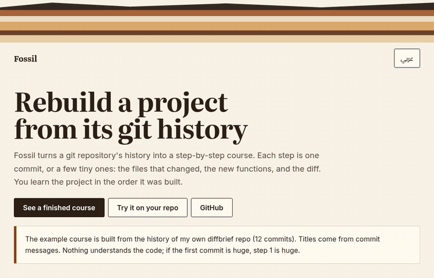

# Fossil

[](https://github.com/mohamed-elshamy-ai/fossil/actions/workflows/tests.yml)

Rebuild a project from its git history. Fossil reads a repository's commits and writes a step-by-step course: each step is one commit (or a few tiny ones) with the files that changed, the functions and classes it adds, a "try writing these first" list, and the diff. You learn the project in the order it was built, not as a finished pile of files.

**Site and finished example:** https://mohamed-elshamy-ai.github.io/fossil/ . You can also paste `git log` output into the page and build a course in your browser (Python via Pyodide, about 10 MB the first time from jsDelivr; nothing is uploaded).



About 20 seconds, recorded from the live page. [MP4 version](docs/demo.mp4).

## Worked example

Built from the history of my own [diffbrief](https://github.com/mohamed-elshamy-ai/diffbrief) repo: 12 commits became 12 steps. Files: [`demo/diffbrief-course.html`](demo/diffbrief-course.html), [`demo/diffbrief-course.md`](demo/diffbrief-course.md).

```
$ fossil ~/diffbrief --out course.html --md course.md
wrote course.html: 12 commits -> 12 steps
```

Step 4 of the course (from the Markdown output, shortened):

```
## 4. Test awareness: flag logic changes with no matching test change in the diff
`git checkout 13a13e0` · medium · +112 -5 · 2026-11-26

Try first, before reading the diff, write:
- `function _stem in diffbrief.py`
- `function _test_awareness in diffbrief.py`
- `function test_untested_change_flagged in tests/test_diffbrief.py`
- `function test_matching_test_clears_flag_and_counts_tests in tests/test_diffbrief.py`
...
Files: modified `README.md` (+2 -1), modified `diffbrief.py` (+72 -4), modified `tests/test_diffbrief.py` (+38 -0)
```

This history also shows the weak spots: compiled `.pyc` files were committed in it and show up as binary files in several steps; step 1 is the whole first commit (1210 added lines), and several steps are design polish rather than new features. The course is only as good as the history.

## Install and use

```
git clone https://github.com/mohamed-elshamy-ai/fossil && cd fossil
pip install .
fossil path/to/repo                       # writes course.html
fossil path/to/repo --md course.md        # also Markdown
fossil path/to/repo --max-steps 20 --rev v1.2.0
```

Standard library only, plus the `git` program. Python 3.9 or newer.

| System | Status |
|---|---|
| Linux | Tested (Python 3.10, git 2.x). |
| Windows / macOS | Should work, not tested. |

## How it works

1. `git log --reverse --no-merges -p` gives every commit with its diff. Merge commits are skipped.
2. The output is parsed into commits and files (added, modified, deleted, renamed, binary), counting added and removed lines.
3. Neighbouring tiny commits (under 12 changed lines) are merged, then the smallest neighbours are merged until at most 30 steps remain.
4. Per step: title from the commit message, size label (small under 40 changed lines, medium under 200, large above), and the "new things" found by simple patterns on added lines (Python `def` and `class`, JavaScript and TypeScript `function` and arrow functions, Go `func`, Rust `fn`, Java-style methods). Steps that add more than 3 files get a suggested build order: smaller first, tests and docs last.
5. Render one self-contained HTML page (all commit text is HTML-escaped) or Markdown.

No AI model. No code is run.

## Measured

- Parsing check on the real histories of my nine repos: **181 of 181 commits** have added and removed line counts equal to `git show --numstat` ([`demo/parse-check.txt`](demo/parse-check.txt)). The check found two real bugs while I built it: a decoding crash on non-UTF-8 bytes in one repo, and miscounting of content lines that begin with `---` or `+++`. Both are fixed.
- 6 pytest tests: parsing and "new things" on a temporary repo, counts against `git numstat`, HTML escaping of a hostile commit message, merging and the step cap, merged add-then-delete status, command line.
- Not measured: how good the courses are for learning. I have not tested them on a learner.

## Limitations

- It does not understand code. Titles are commit messages; "new things" are pattern matches and can miss or misfire (decorators, macros, languages not listed).
- Messy history ("fix", "wip", giant first commit) gives a weak course. Squashed repositories give one step.
- Merging tiny commits loses detail; merge commits are skipped, so work that exists only in a merge commit is not shown.
- Nothing is run, so a step may not work on its own. Binary files are listed, not shown. Diffs longer than 400 lines per file are cut in the HTML (Markdown lists files only).
- `git checkout` commands in the course use the last commit of each step.

## Related tools

[GitHub's own commit history views](https://docs.github.com/en/repositories) show diffs one at a time; Fossil orders and groups them as lessons. Tools such as `git log -p` give the raw material; Fossil adds the grouping, the size labels and the reading order.

## License

MIT.
